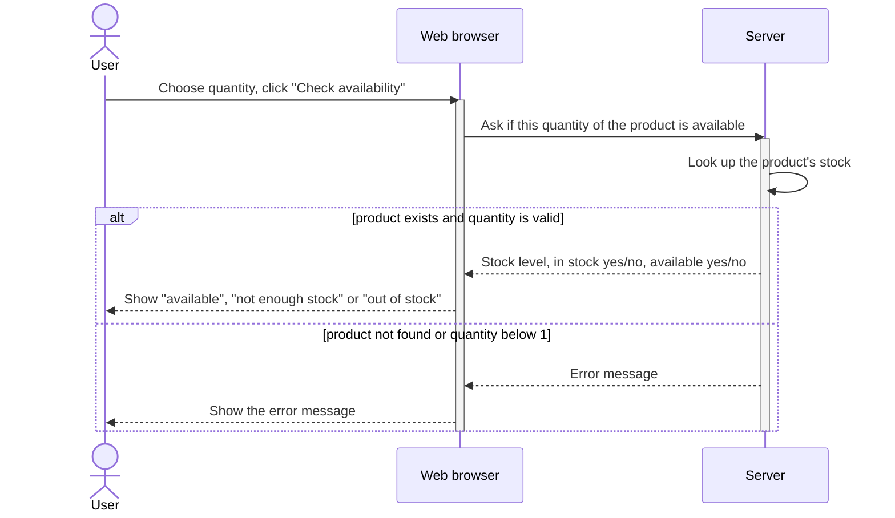
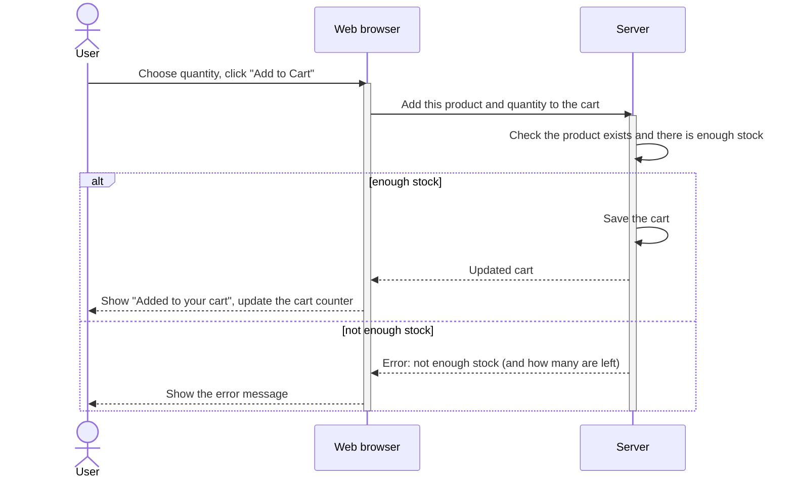

# Sequence diagrams: how the front-end and the backend talk

Two simple diagrams showing the general idea. Written in Mermaid (renders on GitHub, in VS Code with a Mermaid
extension, and at https://mermaid.live where it can also be exported as an image).

* **Web browser** = the front-end (HTML/JS files in this project)
* **Server** = the Spring Boot backend + its database

## 1) Check product availability

Button "Check availability" on the product page. It only reads data: nothing is reserved or changed.
Request: `GET /products/{id}/stock?quantity=N`

## 2) Add products to the shopping cart

Button "Add to Cart" on the product page.
Request: `POST /carts/user/{userId}/items` with the product id and the quantity.
(A guest who is not logged in has the cart saved in the browser instead; the stock check is the same.)

## Promela models (for Spin)

`docs/promela/` has one model per diagram. Each lane is a process, each arrow a send + receive, and the `alt / else` box is an `if ... fi`.
Neither simple diagram contains a loop (an `alt` is a choice, not a repetition), so the models have no `do ... od`.

| File | Models | Checked by Spin |
|---|---|---|
| `add_to_cart.pml` | diagram 2 | no assertion fails, cart never exceeds the stock (LTL), every run ends |
| `check_availability.pml` | diagram 1 | for every stock 0-5, quantity 0-5, product exists or not: the message shown is the right one |
| `merge_with_loop.pml` | the detailed cart-merge diagram (the only one with a `loop`) | `do ... od` version |
| `merge_without_loop.pml` | same flow, no loop (one "add all lines" message) | straight-line version |

Run one: `spin -a add_to_cart.pml && gcc -o pan pan.c && ./pan` (expect `errors: 0`).

## More detail

The first, detailed versions (real file, class and method names, every error code, the guest cart and the cart merge at login)
are in `docs/detailed/`. They are useful when designing white-box tests.
