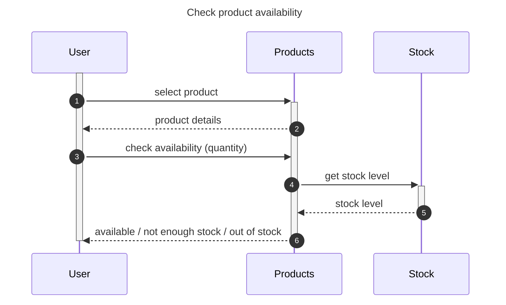
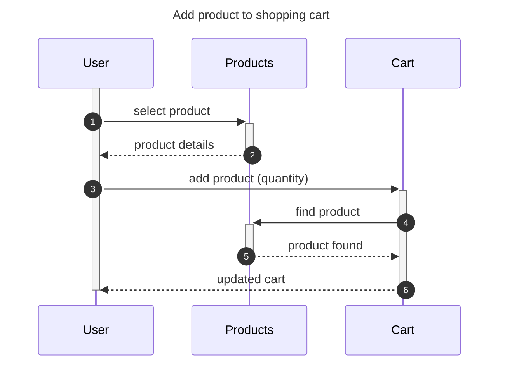

# Sequence diagrams between the elements (like the Online Grocery Shop example)

Lanes are the elements of the shop: **User**, **Products**, **Stock**, **Cart**. Every arrow is one message, numbered in order. Normal case only.
The two use cases are separate: checking availability is not part of adding to the cart.
The Promela models are in `docs/clear/*.pml` (lane = process, arrow N = one send + one receive).

## 1) Check product availability

## 2) Add products to the shopping cart

## What each arrow is in the real application

The browser and the server are not drawn: they are only the way the messages travel. The messages are HTTP requests (API calls) sent by `fetch()` in `js/api.js` to the Spring Boot backend, answered with JSON; the page's JavaScript then updates the screen.

| Diagram | Arrow | In the application |
|---|---|---|
| Check availability | 1-2 select product / product details | opening the product page: `GET /products/{id}` -> JSON with name, price, stock |
| | 3 check availability (quantity) | button "Check availability": `GET /products/{id}/stock?quantity=N` |
| | 4-5 get stock level / stock level | the backend reads the product's stock from the database |
| | 6 available / not enough stock / out of stock | JSON (stock, inStock, available); the page shows the message |
| Add to cart | 1-2 select product / product details | opening the product page: `GET /products/{id}` |
| | 3 add product (quantity) | button "Add to Cart": `POST /carts/user/{userId}/items` with JSON (productId, quantity) |
| | 4-5 find product / product found | the backend looks the product up in the database |
| | 6 updated cart | `200 OK` with JSON of the cart; the page shows "Added" and updates the cart counter |

Check a model with Spin: `spin -a add_to_cart.pml && gcc -o pan pan.c && ./pan` (expect `errors: 0`).
