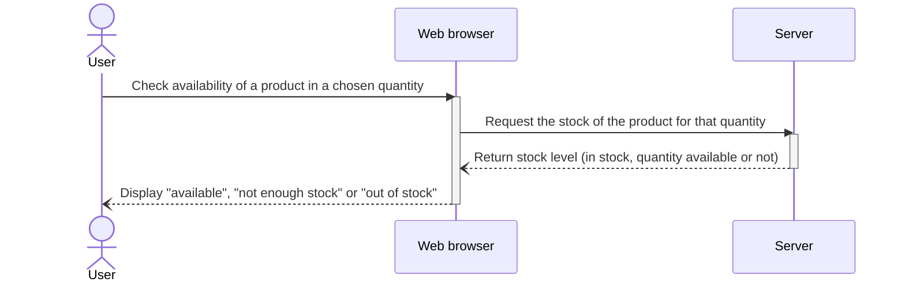
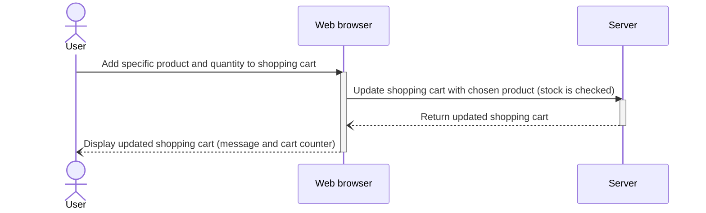

# Sequence diagrams (same style as the reference diagram)

One diagram per use case: User, Web browser, Server, one straight path, no branching.
Solid arrows go forward, dashed arrows are replies. Error cases are not drawn (see the other versions in `docs/` for those).

## 1) Check product availability
Request: `GET /products/{id}/stock?quantity=N`

## 2) Add products to the shopping cart
Request: `POST /carts/user/{userId}/items` (a guest's cart is kept in the browser instead)

