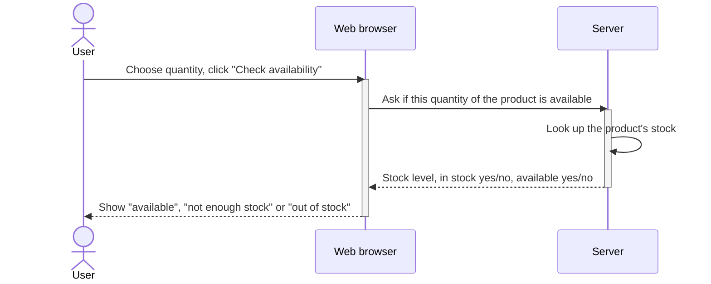
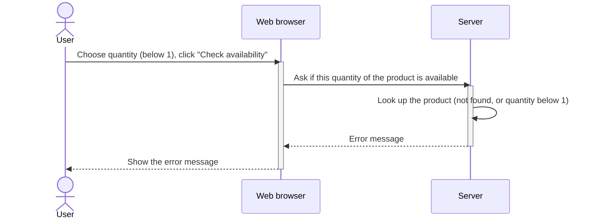
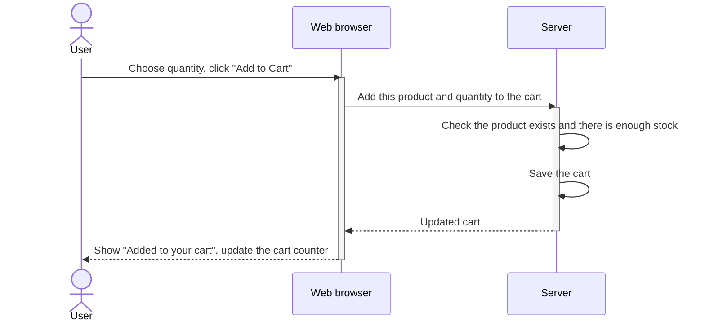
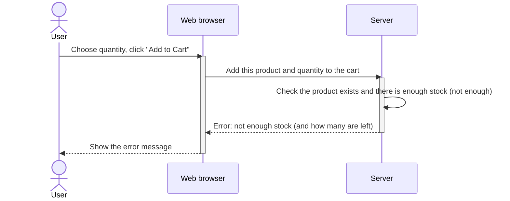

# Straight-line versions (no `alt` box)

The same two use cases, with no branching. Each use case is split into two diagrams: the normal flow and the problem flow.
Each diagram is correct for its own scenario and reads top to bottom. Use these instead of the `alt` versions if you prefer.

Trade-off: one diagram no longer shows both outcomes, so keep the pair together (a test for the error case should point at the "problem" diagram).

## 1) Check product availability

### 1a) The server answers

### 1b) Invalid request (product not found, or quantity below 1)

## 2) Add products to the shopping cart

### 2a) Enough stock

### 2b) Not enough stock

