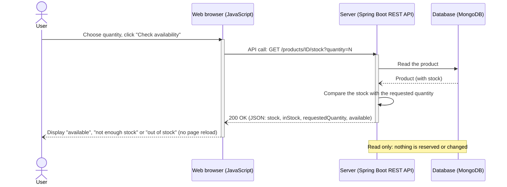
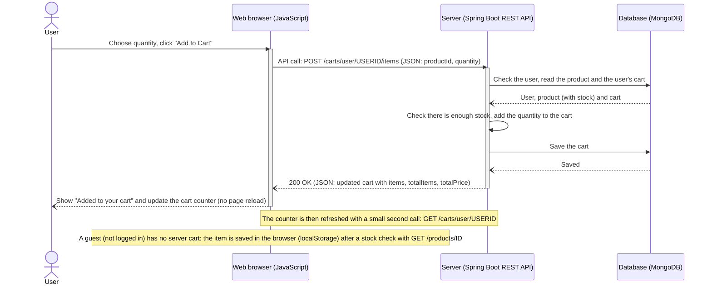

# Sequence diagrams with the API call shown

Same style as the reference diagram, with the technical detail added: how the request is sent and where the data is read and saved.
Error cases are not drawn.

## How the request is made

* The page's JavaScript calls a function in `js/api.js` (for example `apiAddToCart`), which uses the browser's `fetch()` to send an **HTTP request**
  to the backend REST API at `http://localhost:8080`.
* The request carries the data as **JSON** in the body (POST/PUT) or in the address (GET): this is the "API call".
* The backend (Spring Boot: controller -> service -> repository) reads/saves data in **MongoDB** and answers with **JSON** and an HTTP status (200 OK, ...).
* The server does **not** send a page back. The browser's JavaScript reads the JSON and updates the screen itself (no page reload).
* There is no login token: the logged-in user's id is part of the address (`/carts/user/USERID/...`).

## 1) Check product availability

## 2) Add products to the shopping cart

